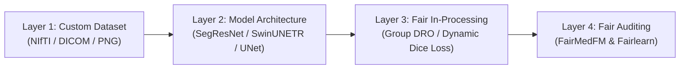

# Developer Guide: Adapting Custom Datasets & Models for Fair Medical Image Segmentation

This guide provides a step-by-step tutorial for deep learning researchers and clinical data scientists to:
1. **Plug in their own medical imaging data** (NIfTI `.nii.gz`, DICOM, PNG/TIFF, NumPy).
2. **Swap in arbitrary segmentation architectures** (MONAI `SegResNet`, `SwinUNETR`, `DynUNet`, `VNet`, custom PyTorch models).
3. **Train with In-Processing Fairness** (`Group DRO` and `Dynamic Inverse-Dice Reweighting`).
4. **Audit existing or pre-trained models** using `FairMedFM` and `Fairlearn`.

---

## 1. Architectural Modularity

The framework is decoupled into 4 independent layers:



Because loss functions and auditing metrics operate purely on standard PyTorch tensors and NumPy arrays, **no internal framework modification is needed**.

---

## 2. Step 1: Connecting Your Own Dataset

To adapt your data, your PyTorch `Dataset` only needs to return:
* `"image"`: Tensor of shape `(C, H, W)` or `(C, D, H, W)` normalized to `[0, 1]` or zero-mean unit-variance.
* `"mask"`: Tensor of shape `(1, H, W)` or `(1, D, H, W)` with integer class labels ($0, 1, \dots$).
* `"group"`: Integer group identifier `0, 1, \dots, G-1` (e.g. scanner vendor, sex, hospital site).
* `"metadata"`: String or dictionary containing raw clinical attributes (patient ID, age, sex, vendor).

### Example: Custom NIfTI Dataset with MONAI Transforms

```python
import os
import pandas as pd
import torch
from torch.utils.data import Dataset
import monai.transforms as mt
import nibabel as nib

class CustomClinicalNiftiDataset(Dataset):
    """
    Generic dataset loader for 2D/3D NIfTI volumes with demographic metadata.
    """
    def __init__(self, csv_file: str, img_dir: str, mask_dir: str):
        self.df = pd.read_csv(csv_file)
        self.img_dir = img_dir
        self.mask_dir = mask_dir

        # Map sensitive attribute (e.g., scanner vendor or demographic) to integer IDs
        self.group_column = "scanner_vendor"  # or "biological_sex", "age_bracket", "site"
        self.unique_groups = sorted(self.df[self.group_column].unique())
        self.group_to_id = {g: i for i, g in enumerate(self.unique_groups)}
        self.group_ids = [self.group_to_id[g] for g in self.df[self.group_column]]

        # MONAI preprocessing transforms
        self.transforms = mt.Compose([
            mt.LoadImaged(keys=["image", "mask"]),
            mt.EnsureChannelFirstd(keys=["image", "mask"]),
            mt.ScaleIntensityRangePercentilesd(keys=["image"], lower=0.5, upper=99.5, b_min=0.0, b_max=1.0),
            mt.Resized(keys=["image", "mask"], spatial_size=(128, 128), mode=["bilinear", "nearest"]),
            mt.EnsureTyped(keys=["image", "mask"], dtype=[torch.float32, torch.float32])
        ])

    def __len__(self):
        return len(self.df)

    def __getitem__(self, idx):
        row = self.df.iloc[idx]
        data_dict = {
            "image": os.path.join(self.img_dir, row["image_filename"]),
            "mask": os.path.join(self.mask_dir, row["mask_filename"])
        }
        transformed = self.transforms(data_dict)
        
        return {
            "image": transformed["image"],
            "mask": transformed["mask"],
            "group": torch.tensor(self.group_ids[idx], dtype=torch.long),
            "vendor": row["scanner_vendor"],
            "age": row["patient_age"],
            "sex": row["patient_sex"],
            "patient_id": row["patient_id"]
        }
```

### Formatting your Metadata CSV
Your metadata CSV (`dataset_metadata.csv`) should look like this:
```csv
patient_id,image_filename,mask_filename,scanner_vendor,patient_age,patient_sex
PAT_001,pat_001_t2w.nii.gz,pat_001_mask.nii.gz,Siemens,62,Male
PAT_002,pat_002_t2w.nii.gz,pat_002_mask.nii.gz,GE,74,Female
PAT_003,pat_003_t2w.nii.gz,pat_003_mask.nii.gz,Philips,49,Male
```

---

## 3. Step 2: Swapping Model Architectures

The training and auditing routines accept **any network that outputs logits**:
$$\hat{y} = f_\theta(x) \in \mathbb{R}^{B \times C \times H \times W} \quad \text{or} \quad \mathbb{R}^{B \times C \times D \times H \times W}$$

### MONAI SegResNet (State-of-the-Art Medical ResNet)
```python
from monai.networks.nets import SegResNet

model = SegResNet(
    spatial_dims=2,       # or 3 for volumetric 3D scans
    in_channels=1,        # 1 for grayscale MRI/CT, 3 for RGB histopathology
    out_channels=2,       # 2 for Binary (Background + Target), >2 for Multi-class
    init_filters=16,
    blocks_down=(1, 2, 2, 4),
    blocks_up=(1, 1, 1)
).cuda()
```

### MONAI SwinUNETR (Vision Transformer for 3D/2D Segmentation)
```python
from monai.networks.nets import SwinUNETR

model = SwinUNETR(
    img_size=(128, 128),
    in_channels=1,
    out_channels=2,
    feature_size=24,
    use_checkpoint=True
).cuda()
```

### Custom PyTorch or torchvision Model
```python
import torchvision.models.segmentation as seg

# Standard DeepLabV3+ with custom final head
model = seg.deeplabv3_resnet50(num_classes=2).cuda()
```

---

## 4. Step 3: Integrating Fairness into Your Training Loop

Integrating Group DRO or Dynamic Inverse-Dice into an existing PyTorch training loop requires **less than 10 lines of code**:

```python
from fair_med_utils import GroupDROLoss, FairGroupBatchSampler
from torch.utils.data import DataLoader

# 1. Stratified batching: Guarantees samples from all scanner vendors in every batch
sampler = FairGroupBatchSampler(dataset.group_ids, batch_size=12)
train_loader = DataLoader(dataset, batch_sampler=sampler)

# 2. Instantiate Group DRO Loss Module
num_subgroups = len(dataset.unique_groups)  # e.g. 3 (Siemens, Philips, GE)
criterion = GroupDROLoss(num_groups=num_subgroups, step_size=0.08).cuda()
optimizer = torch.optim.AdamW(model.parameters(), lr=1e-3, weight_decay=1e-4)

# 3. Standard PyTorch Training Loop
for epoch in range(num_epochs):
    model.train()
    for batch in train_loader:
        images = batch["image"].cuda()
        targets = batch["mask"].cuda()
        groups = batch["group"].cuda()  # (B,) group IDs

        logits = model(images)
        
        # Computes worst-group loss and updates adversarial weights online
        loss, group_losses, q_weights = criterion(logits, targets, groups)

        optimizer.zero_grad()
        loss.backward()
        optimizer.step()
```

> [!TIP]
> **Hyperparameter Guidance:**
> * `step_size` ($\eta_q$): Set between `0.01` and `0.10`. Larger values ($\sim 0.08$) respond aggressively to hard groups; smaller values ($\sim 0.02$) provide smoother adaptation.
> * For Dynamic Inverse-Dice: Set focusing exponent $\gamma = 1.5 - 2.0$ and EMA momentum $\beta = 0.85$.

---

## 5. Step 4: Auditing Any Pre-Trained Model with FairMedFM & Fairlearn

You can audit any pre-trained checkpoint without retraining from scratch:

```python
import fairmedfm as fm
from fairlearn.metrics import MetricFrame
import numpy as np

# 1. Collect per-patient test scores
# You can pass raw arrays, predicted masks, or calculated Dice scores
test_dice_scores = np.array([...])         # Shape: (N_test,)
test_scanner_vendors = np.array([...])     # Shape: (N_test,) ["Siemens", "GE", ...]
test_patient_ages = np.array([...])        # Shape: (N_test,) [62, 74, 49, ...]

# 2. Audit with FairMedFM
gap = fm.dice_gap(dice=test_dice_scores, sensitive_features=test_scanner_vendors)
es_dice = fm.equity_scaled_dice(dice=test_dice_scores, sensitive_features=test_scanner_vendors)
report = fm.evaluate_segmentation(
    sensitive_features=test_patient_ages,
    dice=test_dice_scores,
    bins={"age": [50, 70]}  # Automatically bins continuous age into <50, 50-70, >70
)

print(f"Worst-Group Disparity Gap (ΔDSC): {gap:.4f}")
print(f"Equity-Scaled Dice (ES-Dice)    : {es_dice:.4f}")
print(report.summary)

# 3. Audit with Fairlearn MetricFrame (80% Disparate Impact Rule)
def mean_metric(y_true, y_pred):
    return float(np.mean(y_pred))

mf = MetricFrame(
    metrics={"Mean DSC": mean_metric},
    y_true=test_dice_scores,
    y_pred=test_dice_scores,
    sensitive_features=test_scanner_vendors
)

print("Subgroup Breakdown:")
print(mf.by_group)
print(f"Disparity Ratio (Min / Max): {mf.ratio()['Mean DSC']:.4f}")
# If ratio >= 0.80 -> Complies with EEOC/FDA 80% Rule!
```

---

## 6. Real-World Clinical Adaptation Examples

### Example A: Multi-Vendor Prostate T2W MRI Segmentation
* **Task:** Peripheral zone (PZ) vs Transition zone (TZ) prostate segmentation.
* **Sensitive Attribute:** Scanner vendor (`Siemens Skyra 3T`, `Philips Achieva 1.5T`, `GE Signa 1.5T`).
* **Clinical Disparity:** 1.5T scanners suffer lower contrast at the prostate capsule boundary.
* **Action:** Pass `group = scanner_type` into `GroupDROLoss` to prevent under-segmentation on 1.5T systems.

### Example B: Non-Small Cell Lung Cancer (NSCLC) CT Segmentation
* **Task:** Gross Tumor Volume (GTV) delineation.
* **Sensitive Attribute:** Biological Sex (`Male` vs `Female`) or Age (`<60` vs `>70`).
* **Clinical Disparity:** Lower thoracic contrast and chronic obstructive pulmonary changes in elderly cohorts.
* **Action:** Pass binned age or sex into `DynamicInverseDiceLoss` to dynamically upweight senescent lung slices.

---

## 7. Summary Checklist for Developers

| Step | Action | Completed? |
| :--- | :--- | :---: |
| 1 | Create metadata CSV with columns: `image_path`, `mask_path`, `sensitive_group` | [ ] |
| 2 | Subclass PyTorch `Dataset` returning `"image"`, `"mask"`, and integer `"group"` | [ ] |
| 3 | Use `FairGroupBatchSampler` in `DataLoader` to avoid empty subgroup batches | [ ] |
| 4 | Initialize any MONAI or PyTorch model (`UNet`, `SegResNet`, `SwinUNETR`) | [ ] |
| 5 | Replace loss with `GroupDROLoss` or `DynamicInverseDiceLoss` | [ ] |
| 6 | Evaluate test predictions with `fm.dice_gap()` and Fairlearn `MetricFrame` | [ ] |
| 7 | Verify Disparity Ratio $\ge 0.80$ for FDA/EU AI Act regulatory compliance | [ ] |
